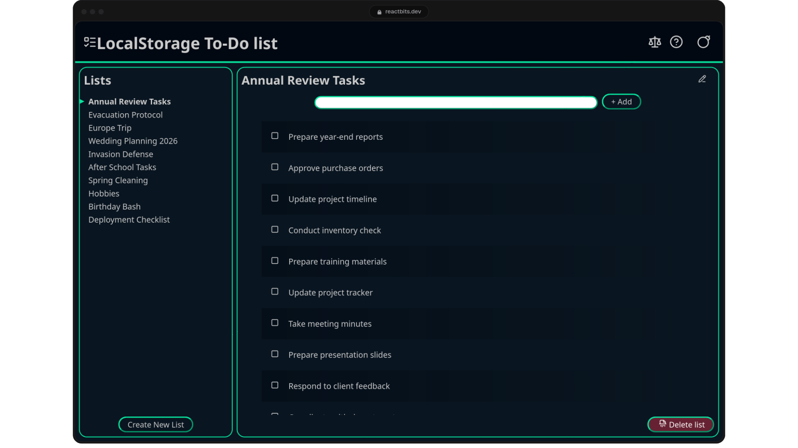

# VanillaJS To-do Lists

VanillaJS To-do Lists is a portfolio frontend demo. Built in JavaScript with no
runtime dependencies, it uses native Web Components, Shadow DOM and localStorage
to manage multiple lists and their items.



## What it is

This desktop web application is a technical demonstration of a frontend written
entirely in JavaScript, without the use of any component libraries or similar
tools.

The icons used in the application come from the
[lucide-icons/lucide](https://lucide.dev/) package, but have been recreated in
JavaScript.

## What the application and I are not

In no way, shape or form is this application production-ready; it doesn't claim
to be, and probably never will be. You will not find any backend,
authentication, multi-user support, advanced features, or AI integrations. There
is no responsive layout, and it is not meant to work on a phone or tablet.

I'm not a graphic designer and did not use any kind of resource (human or AI)
for the visual design process.

## Lint, format and types

Prettier and ESLint are used to maintain consistent formatting and coding
standards.

Even though the entire code is written in JavaScript, TypeScript is configured
to verify the JSDoc type annotations.

```shell
pnpm run check         # Execute Prettier, ESLint and tsc
pnpm run check:types   # Verify types using tsc
pnpm run check:format  # Verify code formatting
pnpm run check:lint    # Verify lint rules
pnpm run fix:lint      # Fix ESLint errors when possible
pnpm run fix:format    # Format files using Prettier
pnpm run markdownlint  # Verify markdown files formatting
```

## Tests

The project has E2E (Playwright) and unit tests (Vitest). Test files, helpers,
and harnesses are located in the `tests/` folder.

```shell
pnpm run test            # Runs unit tests and, if they pass, E2E tests.
pnpm run test:unit       # Runs unit tests.
pnpm run test:e2e        # Runs E2E tests
pnpm run test:e2e:ui     # Open the Playwright UI
pnpm run test:e2e:report # Open the last Playwright HTML report
```

## Documentation

Documentation is generated in the `docs/` folder using
[typedoc](https://typedoc.org/).

```shell
pnpm run docs:build
```

## License

See [LICENSE](./LICENSE)
