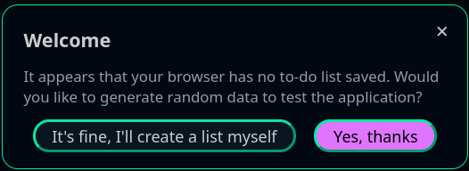

# First steps

The first time you are accessing the application, a welcome message will ask you if you want demontration data to be created automatically.

This message appears each time you are accessing the application as long as your browser data does not contain a list.
