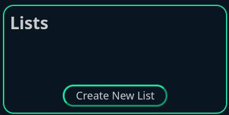
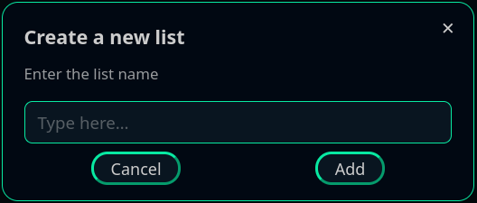
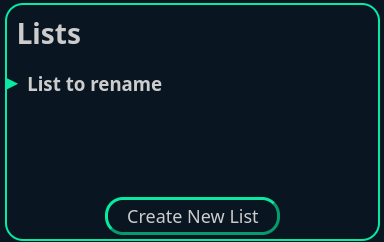
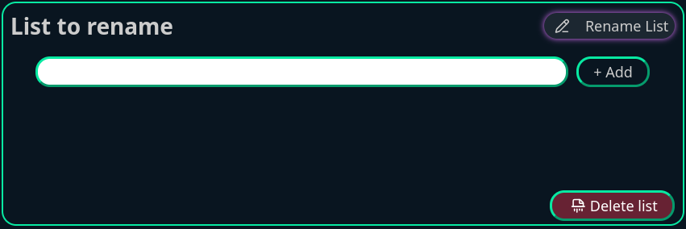
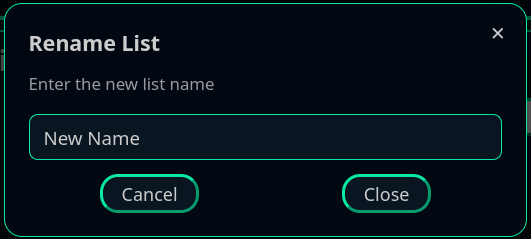
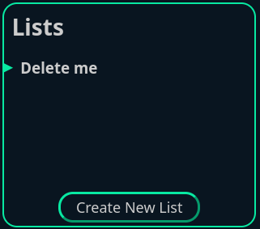
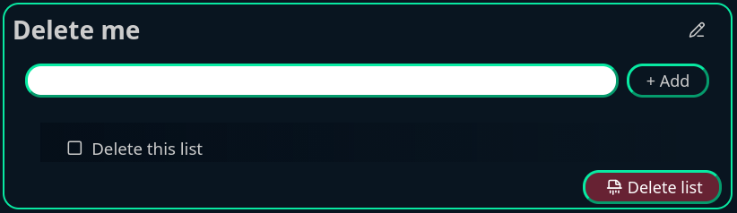

# Create, rename and delete list

## Create a new list

1. Click on the "Create New List" button at the bottom of the left pane. \

2. Enter the name of your new list. \

## Rename an existing list

1. Select the list to rename in the navigation pane \

2. In the list detail pane, click on the pencil icon
 \

3. Enter the new name for the list. \

## Delete a list

1. Select the list to delete in the navigation pane \

2. In the list detail pane, click on the "Delete list" button \

3. Confirm the action \

## Delete all existing lists

1. Click on the bomb icon in the header 

2. Confirm the action \

> [!Note]
> When the  action is completed, the page will reload and the
> [welcome message](/user-guide/first-steps) will be showned.
